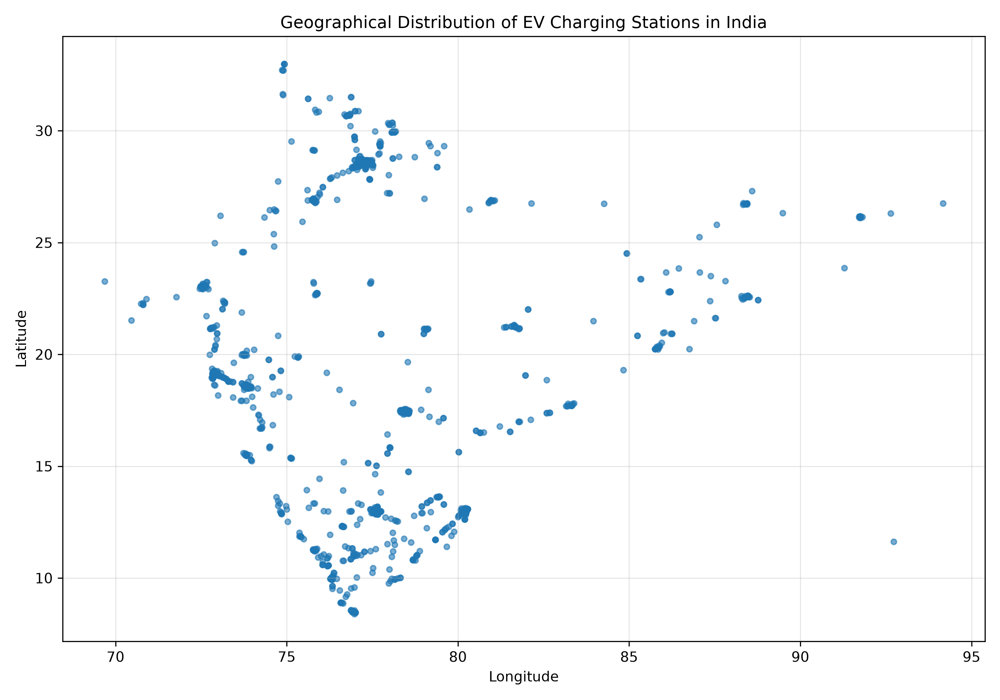
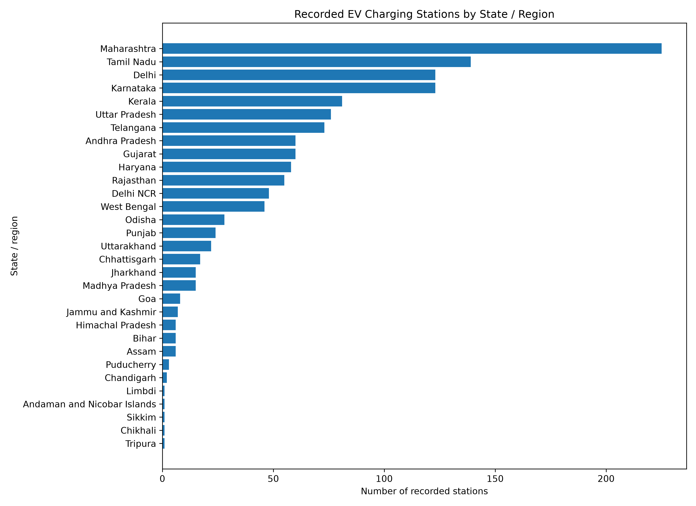
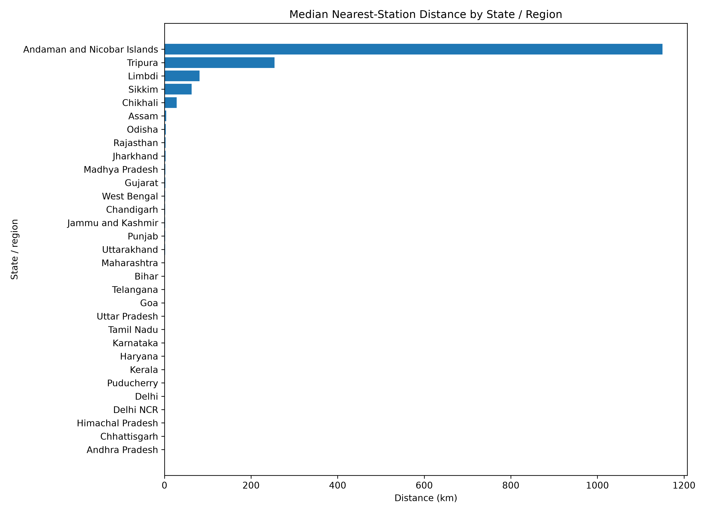

# Spatial Clustering of EV Charging Stations to Identify Coverage Gaps in India

## 1. Project Overview

Electric vehicles (EVs) play an important role in the transition towards sustainable transportation. However, the geographical distribution of EV charging infrastructure is uneven, potentially creating accessibility challenges for EV users.

This project applies spatial clustering and geographic distance analysis to study the distribution of EV charging stations across India. K-Means and Agglomerative Hierarchical Clustering are used to identify geographical patterns, while nearest-neighbour and grid-based distance analysis are used to investigate potential charging infrastructure gaps.

The project supports UN Sustainable Development Goals SDG 7 (Affordable and Clean Energy) and SDG 11 (Sustainable Cities and Communities).

## 2. Project Objectives

- Examine the geographical distribution of EV charging stations.
- Apply K-Means and Hierarchical Clustering to geographical coordinates.
- Determine suitable cluster counts using the Elbow Method and Silhouette Score.
- Compare the performance of both clustering algorithms.
- Calculate nearest-neighbour distances using the Haversine formula.
- Identify potential areas with limited proximity to recorded charging stations.
- Conduct state-wise analysis of station distribution and distances.

## 3. Dataset Description

The project uses the Electric Vehicle Charging Stations in India dataset obtained from Kaggle.

The dataset contains station names, states, cities, addresses, latitude, longitude and station types.

### Data preprocessing

The original dataset contained 1,547 records. The cleaned dataset contains 1,331 records.

The preprocessing included:
- Converting geographic coordinates into numeric values.
- Removing duplicate records.
- Handling missing and invalid coordinates.
- Checking geographical coordinate ranges.
- Standardizing selected state and region names for regional analysis.

The supplied cleaned dataset is stored at:

`data/cleaned_ev_stations.csv`

The original dataset is stored at:

`data/ev.csv`

## 4. Methodology

### 4.1 Exploratory Data Analysis

Geographical coordinates and state-wise station counts were examined to understand the distribution of recorded EV charging stations.

### 4.2 K-Means Clustering

K-Means was applied to standardized latitude and longitude coordinates.

The number of clusters was evaluated for K values ranging from 2 to 10 using:
- Elbow Method (Inertia)
- Silhouette Score

The best silhouette score was obtained at K = 4.

### 4.3 Hierarchical Clustering

Agglomerative Hierarchical Clustering was implemented using Ward linkage.

Different cluster counts were evaluated using Silhouette Scores. A dendrogram was also generated using a sample of station coordinates to illustrate the hierarchical merging process.

### 4.4 Clustering Comparison

Both algorithms were evaluated using the same standardized coordinate representation and cluster counts ranging from 2 to 10.

Their silhouette scores were compared to identify the better-performing configuration among those tested.

### 4.5 Geographic Distance Analysis

The Haversine formula was used with a BallTree to calculate the great-circle distance between geographical coordinates.

The analysis included:
- Distance from each station to its nearest other station.
- Grid-point distance to the nearest recorded station.
- State-wise summaries of nearest-neighbour distances.

A 25 km threshold was selected as an exploratory indicator of potentially distant charging infrastructure. It is not an official accessibility standard.

The grid was restricted to the convex hull of recorded station coordinates. Therefore, the results represent sampled locations within this boundary, not a complete assessment of India's land area or population accessibility.

## 5. Results and Findings

### 5.1 Clustering Performance

| Algorithm | Number of clusters | Silhouette Score |
|---|---:|---:|
| K-Means | 4 | 0.6469 |
| Hierarchical (Ward) | 4 | 0.6219 |

K-Means achieved the higher silhouette score among the tested configurations. This indicates better separation under the selected coordinate representation and evaluation method.

### 5.2 Station Distribution

The cleaned dataset contains 1,331 recorded charging stations.

Maharashtra has the highest station count in the state-wise analysis, with 225 records.

The distribution indicates that recorded charging infrastructure is concentrated in certain regions, while other regions contain fewer recorded stations.

### 5.3 Nearest-Neighbour Analysis

The nearest-other-station distance analysis produced:

| Metric | Result |
|---|---:|
| Number of stations | 1,331 |
| Mean distance | 7.34 km |
| Median distance | 1.00 km |
| Maximum distance | 1,150.09 km |

The large maximum distance indicates that some recorded stations are geographically isolated from other stations in the dataset.

### 5.4 Potential Coverage Gaps

The grid-based analysis produced:

| Metric | Result |
|---|---:|
| Grid points evaluated | 9,943 |
| Points beyond 25 km | 8,954 |
| Percentage beyond 25 km | 90.05% |
| Median distance | 102.27 km |
| Maximum distance | 708.03 km |

These results identify sampled geographical locations that are more than 25 km from a recorded charging station.

The percentage applies only to the evaluated grid points. It must not be interpreted as the percentage of India's population or land area without charging access.

## 6. Technologies Used

- Python
- Pandas
- NumPy
- Matplotlib
- Scikit-learn
- SciPy

## 7. Project Structure

```text
EV_Charging_Clustering/
├── data/
│   ├── ev.csv
│   └── cleaned_ev_stations.csv
├── outputs/
├── src/
│   ├── main.py
│   ├── kmeans_clustering.py
│   ├── hierarchical_clustering.py
│   ├── compare_clustering.py
│   ├── coverage_gap_analysis.py
│   └── state_wise_analysis.py
├── .gitignore
├── Requirements.txt
├── README.md
└── EV_charging_stations_report.pdf
```

## 8. How to Run the Project

### Install dependencies

From the project root directory, run:

```bash
pip install -r Requirements.txt
```

### Execute the analysis scripts

```bash
python src/main.py
python src/kmeans_clustering.py
python src/hierarchical_clustering.py
python src/compare_clustering.py
python src/coverage_gap_analysis.py
python src/state_wise_analysis.py
```

On Windows, `py` can be used instead of `python`.

Run commands from the project root directory because the scripts use relative paths.

The cleaned dataset is supplied in the data folder. The analysis scripts generate their respective CSV tables and visualizations in the outputs folder.

## 9. Limitations

- The dataset may not contain every operational EV charging station in India.
- Incorrect or inconsistent geographical coordinates may affect the analysis.
- Standardized latitude and longitude with Euclidean-based clustering do not account for Earth's curvature in the same way as Haversine distance.
- Haversine distance measures straight-line distance rather than actual road-network travel distance.
- The 25 km threshold is an exploratory analytical choice.
- Grid-based estimates depend on the selected grid resolution and convex-hull boundary.
- The analysis does not incorporate population density, EV ownership, charging capacity, station reliability or traffic patterns.
- State-wise results may be affected by inconsistent region names and small sample sizes.

Therefore, the findings should be interpreted as exploratory spatial analysis rather than a definitive measurement of EV charging accessibility.

## 10. Sustainable Development Goals

**SDG 7 – Affordable and Clean Energy**

The project supports research into the geographical availability of infrastructure required for electric mobility.

**SDG 11 – Sustainable Cities and Communities**

The project examines spatial inequalities in charging infrastructure and identifies areas that may require further investigation.

## 11. Conclusion

This project demonstrates the application of unsupervised machine learning and geographic distance analysis to examine EV charging infrastructure distribution in India.

K-Means achieved the highest silhouette score among the evaluated configurations at four clusters, while Hierarchical Clustering provided a second perspective on geographical grouping.

Nearest-neighbour and grid-based distance analysis highlighted substantial variations in the proximity of recorded charging stations.

The findings can support preliminary infrastructure planning. Future research could improve the analysis by incorporating population density, road networks, EV registrations, charging capacity and operational station data.

## 12. Data Source

Electric Vehicle Charging Stations in India dataset, obtained from Kaggle.

The original dataset source and licence should be consulted for attribution and usage conditions.
# EV Charging Station Clustering & Coverage Gap Analysis

## 1. Problem Framing & Objective
- **Objective:** To perform spatial clustering of Electric Vehicle (EV) charging stations and identify regional coverage gaps to optimize future infrastructure planning.
- **Significance:** Helps policymakers and stakeholders determine high-density clusters versus underserved desert regions.

## 2. Exploratory Data Analysis (EDA)
- **Data Overview:** Cleaned station data from `cleaned_ev_stations.csv` containing geographical coordinates and state distributions[cite: 2].
- **Key Visualizations & Insights:**
  - **Station Distribution:** Visualizes the geographic spread across regions[cite: 2].
    
  - **State-wise Counts:** Highlights disparities in infrastructure availability between states[cite: 2].
    
  - **Median Distance:** Evaluates accessibility gaps per state[cite: 2].
    

## 3. Methodology & Preprocessing
- **Data Cleaning:** Handled missing spatial coordinates and removed outliers to prevent distortion in spatial clustering.
- **Clustering Approach:** Compared K-Means and Hierarchical Clustering using silhouette scores and elbow methods (`outputs/figures/elbow_method.png`, `outputs/figures/silhouette_scores.png`)[cite: 2].

## 4. How to Run
```bash
pip install -r Requirements.txt
python src/main.py
